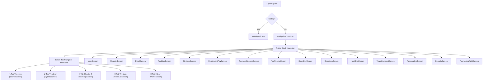

# WanderStay — Agent Architecture & Engineering Guide

Tài liệu quy chuẩn kiến trúc, đặc tả yêu cầu phần mềm (SRS), ánh xạ 28 màn hình thiết kế và hướng dẫn kỹ thuật dành cho Developer và AI Agents tham gia phát triển dự án **WanderStay**.

---

## 1. Giới thiệu chung & Tech Stack

- **Dự án**: WanderStay (Nhóm 6 — Môn Lập trình di động).
- **Mục tiêu**: Nền tảng ứng dụng di động khép kín dành cho khách du lịch tự túc tìm và đặt chỗ ở nghỉ dưỡng; minh bạch giá và phụ phí; thanh toán mô phỏng an toàn; xuất hóa đơn biên nhận PDF; tự động hóa nhận phòng bằng chìa khóa số thông minh (Keyless Smart Key PIN/Bluetooth); tra cứu lộ trình với mốc nhận diện thực tế; nhắn tin 1-1 với chủ nhà và Trợ lý du lịch ảo 24/7.
- **Frontend Framework**: **React Native + Expo** (Managed Workflow), **TypeScript**.
- **Điều hướng (Navigation)**: **React Navigation v6** (`@react-navigation/native-stack`, `@react-navigation/bottom-tabs`).
  > [!IMPORTANT]
  > Dự án dùng React Navigation qua [`AppNavigator.tsx`](file:///d:/TravellingApp/src/navigation/AppNavigator.tsx). **Tuyệt đối KHÔNG dùng Expo Router** (không tạo thư mục `src/app/`, không import từ `expo-router`).
- **Styling**: **NativeWind 4.2.7** + **Tailwind CSS 3.4.19**. [`App.tsx`](file:///d:/TravellingApp/App.tsx) import [`global.css`](file:///d:/TravellingApp/global.css) ở dòng đầu tiên. Màn hình viết bằng `className`. Chỉ giữ `style` cho `contentContainerStyle` của `FlatList`.
- **Bảng màu quy chuẩn (Theme Colors)**:
  - `brand`: `#4F46E5` (Indigo chính)
  - `brandPurple`: `#7C5CFC` (Tím phụ trợ)
  - `dealAmber`: `#FFB020` (Vàng nổi bật / Tag ưu đãi)
  - `appBg`: `#F8F7FF` (Nền ứng dụng sáng)
  - `cardBg`: `#FFFFFF` (Nền thẻ trắng)
  - `textMain`: `#131B2E` (Chữ chính đậm)
  - `textMuted`: `#5A6478` (Chữ phụ mờ)
  - `borderLight`: `#E6E3F5` (Đường viền mỏng)
  - `inactive`: `#8A90A6` (Màu icon/nút chưa kích hoạt)
- **Backend**: **Supabase** (PostgreSQL + Auth + Storage). Truy xuất thông qua thư viện [`src/lib/supabase.ts`](file:///d:/TravellingApp/src/lib/supabase.ts) bằng anon key (`EXPO_PUBLIC_SUPABASE_URL`, `EXPO_PUBLIC_SUPABASE_ANON_KEY`).

---

## 2. Hệ thống Tác nhân & 17 Use Case (Chuẩn hóa theo SRS)

### 2.1. Phân quyền Tác nhân (Actors)
1. **Khách vãng lai (Guest)**: Chưa đăng nhập. Được phép: Khám phá danh mục, tìm kiếm (Where / When / Guests), lọc nâng cao ($10–$250, tiện ích, loại phòng), xem chi tiết chỗ nghỉ, danh mục 28 tiện ích, bài viết giới thiệu, xem đánh giá của khách cũ, đăng ký và đăng nhập.
2. **Khách hàng thành viên (Member / User)**: Đã đăng nhập. Kế thừa toàn bộ quyền của Guest; có quyền đặt phòng, thanh toán mô phỏng (Pay in full / Pay a part now), nhận chìa khóa số thông minh (Smart Key PIN/Bluetooth/QR/Wifi), xem hướng dẫn lộ trình với 3 mốc nhận diện thực tế, tải biên nhận chuyến đi PDF, quản lý chuyến đi cá nhân (Upcoming / Completed / Cancelled), nhắn tin trực tiếp với chủ nhà theo mã booking, tương tác với Trợ lý du lịch ảo 24/7, lưu/quản lý danh sách yêu thích & bộ sưu tập, quản lý thông tin cá nhân, quản lý đăng nhập & bảo mật 2FA, quản lý phương thức thanh toán/ví tiền WanderStay Wallet, và viết đánh giá sau khi hoàn thành kỳ nghỉ.
3. **Quản trị viên (Admin)**: Hệ thống quản trị nội bộ độc lập trên Web/Supabase Table Editor. **Không xây dựng màn hình Admin hoặc Tab Admin trong app mobile**. Thao tác quản lý chỗ ở (bật/tắt `is_visible`) và kiểm tra booking thực hiện trực tiếp trên Supabase.

---

### 2.2. Danh sách 17 Use Case chính thức (UC001 – UC017)

| Mã UC | Tên Use Case | Mô tả chi tiết nghiệp vụ | Nhóm chức năng | Màn hình tương ứng |
| :--- | :--- | :--- | :--- | :--- |
| **UC001** | Đăng ký tài khoản | Đăng ký tài khoản mới bằng SĐT hoặc liên kết mạng xã hội (Apple, Google, Facebook) | Xác thực | `RegisterScreen` |
| **UC002** | Đăng nhập / Đăng xuất | Đăng nhập bằng tài khoản hoặc mạng xã hội; khôi phục phiên làm việc; đăng xuất | Xác thực | `LoginScreen`, `ProfileScreen` |
| **UC003** | Quản lý thông tin cá nhân | Xem và cập nhật họ tên, biệt danh, ngày sinh, email, SĐT, liên hệ khẩn cấp, địa chỉ cư trú | Tài khoản | `ProfileScreen`, `PersonalInfoScreen` |
| **UC004** | Quản lý đăng nhập & bảo mật 2FA | Xem điểm sức khỏe bảo mật (Health Score), đổi mật khẩu chính, cài đặt 2FA (SMS/Authenticator), xem thiết bị đăng nhập | Bảo mật | `SecurityScreen` |
| **UC005** | Quản lý phương thức thanh toán & ví | Quản lý số dư ví WanderStay Wallet ($120), quản lý thẻ Visa/Mastercard/Apple Pay/PayPal, xem lịch sử giao dịch | Tài chính | `PaymentsWalletScreen` |
| **UC006** | Khám phá, Tìm kiếm & Lọc nâng cao | Khám phá theo danh mục (Beach, Mountain, Camping...); Tìm kiếm Where, When, Guests; Lọc giá ($10–$250), loại phòng, số giường, 28 tiện ích; công tắc 'Display total price' | Tìm kiếm | `SearchScreen` (Explore), Search Modals (`Where`, `When`, `Guests`), `FilterModal` |
| **UC007** | Xem chi tiết chỗ ở & tiện nghi | Slide ảnh thực tế, tiện ích nổi bật, xem toàn bộ danh mục 28 tiện nghi/dịch vụ chi tiết, bài viết giới thiệu (Description), chính sách check-in/out | Hiển thị | `DetailScreen`, `FacilitiesScreen`, `DescriptionModal` |
| **UC008** | Xem đánh giá nhận xét | Xem điểm đánh giá trung bình 4.5/5 ⭐, biểu đồ phân bổ số sao (1–5 sao), danh sách bình luận thực tế kèm huy hiệu Verified Stay | Hiển thị | `ReviewsScreen` |
| **UC009** | Quản lý danh sách yêu thích | Lưu/bỏ lưu chỗ ở (bấm tim), hiển thị phân loại theo thẻ hoặc tạo bộ sưu tập mới (+ Create new collection) | Cá nhân | `MyListsScreen` |
| **UC010** | Đặt phòng chỗ nghỉ | Chọn ngày lưu trú, số lượng khách, kiểm tra trùng lịch (báo lỗi 409), kiểm tra sức chứa tối đa và tính toán chi phí lưu trú | Đặt phòng | `DetailScreen`, `ConfirmAndPayScreen` |
| **UC011** | Xác nhận thanh toán & Xuất biên nhận PDF | Chọn Pay in full hoặc Pay a part now, xem bảng kê chi tiết minh bạch các khoản phí; xử lý thanh toán mô phỏng an toàn; sinh mã Ref; xem và tải biên nhận PDF về thiết bị | Thanh toán | `ConfirmAndPayScreen`, `PaymentSuccessScreen`, `TripReceiptScreen` |
| **UC012** | Quản lý chuyến đi cá nhân | Xem danh sách các chuyến đi trong tab Bookings theo trạng thái: Sắp tới (Upcoming), Đã hoàn thành (Completed), Đã hủy (Cancelled); truy cập thao tác nhanh | Chuyến đi | `BookingsScreen` |
| **UC013** | Nhận phòng thông minh & Chìa khóa số | Mở cửa bằng mã PIN 4 chữ số ('4821#'), mở khóa Bluetooth, mã QR cổng vào, thông tin mạng Wifi & mật khẩu, 3 bước nhận phòng và cẩm nang Offline Guide PDF | Lưu trú | `SmartKeyScreen` |
| **UC014** | Hướng dẫn đường đi & Đến nơi | Bản đồ lộ trình, các tùy chọn di chuyển (xe đưa đón sân bay $35, Grab, bãi đỗ xe) và 3 mốc nhận diện thực tế kèm ảnh | Lưu trú | `DirectionsScreen` |
| **UC015** | Nhắn tin trao đổi với Chủ nhà | Nhắn tin trực tiếp 1-1 với chủ nhà (Wayan Sutama) theo mã booking (#WS-84920), hẹn giờ đón sân bay, xin check-in sớm, tự động đánh dấu đã đọc (`is_read`) | Liên lạc | `InboxListScreen`, `HostChatScreen` |
| **UC016** | Trợ lý du lịch ảo hỗ trợ 24/7 | Trò chuyện với Trợ lý ảo tự động (WanderStay Travel Assistant) giải đáp chính sách hủy/hoàn tiền và tải hóa đơn điện tử VAT (`Invoice_REC-20`) | Hỗ trợ | `TravelAssistantScreen` |
| **UC017** | Viết đánh giá sau khi hoàn thành kỳ nghỉ | Chấm điểm sao (1–5) và nhập nội dung đánh giá thực tế cho các đơn đặt phòng ở trạng thái Completed; hệ thống kích hoạt trigger tính lại điểm trung bình | Đánh giá | `WriteReviewModal` |

---

## 3. Bản đồ 28 Màn hình Thực tế (Mapping từ `D:\Travelling`)

Dự án ánh xạ đầy đủ 28 file màn hình thiết kế có trong thư mục `D:\Travelling` vào hệ thống file mã nguồn trong `src/`:

| STT | File Ảnh Thiết Kế (`D:\Travelling`) | Tên Màn Hình / Component | Đường Dẫn File Trong `src/` | Nhóm Chức Năng & Use Case Liên Quan |
| :---: | :--- | :--- | :--- | :--- |
| **1** | `Logo Loading.png` | `SplashScreen` | `src/screens/auth/SplashScreen.tsx` | Màn khởi động / Tải logo WanderStay |
| **2** | `Login.png` | `LoginScreen` | `src/screens/auth/LoginScreen.tsx` | UC002 — Đăng nhập bằng SĐT, Apple, Google, Facebook |
| **3** | `Register.png` | `RegisterScreen` | `src/screens/auth/RegisterScreen.tsx` | UC001 — Đăng ký tài khoản thành viên mới |
| **4** | `index.png` | `SearchScreen` (Explore) | `src/screens/search/SearchScreen.tsx` | UC006 — Khám phá chỗ ở theo danh mục, thanh tìm kiếm |
| **5** | `where.png` | `SearchWhereModal` | `src/screens/search/modals/SearchWhereModal.tsx` | UC006 — Chọn điểm đến (Anywhere, Bali, Europe, Asia...) |
| **6** | `Schaduel.png` | `SearchScheduleModal` | `src/screens/search/modals/SearchScheduleModal.tsx` | UC006 — Chọn khoảng thời gian nhận/trả phòng trên lịch |
| **7** | `guest.png` | `SearchGuestsModal` | `src/screens/search/modals/SearchGuestsModal.tsx` | UC006 — Chọn số lượng khách (Adults, Children, Infants) |
| **8** | `fillter.png` | `FilterModal` | `src/screens/search/modals/FilterModal.tsx` | UC006 — Bộ lọc tổng thể (Loại chỗ, số phòng, tiện ích) |
| **9** | `Price range.png` | `PriceRangeSection` | `src/screens/search/components/PriceRangeSection.tsx`| UC006 — Lọc khoảng giá $10 – $250 chi tiết |
| **10**| `Apply fillter.png` | `SearchScreen` (Results) | `src/screens/search/SearchScreen.tsx` | UC006 — Kết quả lọc kèm công tắc 'Display total price' |
| **11**| `Property details.png` | `DetailScreen` | `src/screens/place/DetailScreen.tsx` | UC007 — Chi tiết phòng, slide ảnh, thông số, nút Reserve |
| **12**| `Description.png` | `DescriptionModal` | `src/screens/place/modals/DescriptionModal.tsx` | UC007 — Toàn văn bài viết giới thiệu chỗ nghỉ & không gian |
| **13**| `Facilities & Services.png`| `FacilitiesScreen` | `src/screens/place/FacilitiesScreen.tsx` | UC007 — Danh sách đầy đủ 28 tiện nghi & dịch vụ chi tiết |
| **14**| `Reviews.png` | `ReviewsScreen` | `src/screens/place/ReviewsScreen.tsx` | UC008 — Đánh giá nhận xét, biểu đồ sao, danh sách bình luận |
| **15**| `favouries.png` | `MyListsScreen` | `src/screens/favorites/MyListsScreen.tsx` | UC009 — Chỗ ở đã lưu yêu thích & Tạo bộ sưu tập mới |
| **16**| `Confirm and pay.png` | `ConfirmAndPayScreen` | `src/screens/booking/ConfirmAndPayScreen.tsx` | UC010, UC011 — Tóm tắt chuyến đi, tùy chọn thanh toán |
| **17**| `Payment success.png` | `PaymentSuccessScreen` | `src/screens/booking/PaymentSuccessScreen.tsx` | UC011 — Xác nhận thanh toán thành công, hiển thị Ref code |
| **18**| `Trip Receipt - WanderStay.png`| `TripReceiptScreen` | `src/screens/booking/TripReceiptScreen.tsx` | UC011 — Hóa đơn biên nhận đầy đủ & Nút tải file PDF |
| **19**| `Bookings - WanderStay.png` | `BookingsScreen` | `src/screens/booking/BookingsScreen.tsx` | UC012 — Quản lý chuyến đi (Upcoming, Completed, Cancelled) |
| **20**| `Check-in & Smart Key - Balian Treehouse.png` | `SmartKeyScreen` | `src/screens/booking/SmartKeyScreen.tsx` | UC013 — Chìa khóa số, PIN 4821#, Bluetooth, QR, Wifi |
| **21**| `Directions & Arrival - Balian Treehouse.png` | `DirectionsScreen` | `src/screens/booking/DirectionsScreen.tsx` | UC014 — Lộ trình di chuyển, xe đưa đón $35, 3 mốc nhận diện |
| **22**| `Inbox - WanderStay.png` | `InboxListScreen` | `src/screens/inbox/InboxListScreen.tsx` | UC015, UC016 — Hộp thư đến (Hội thoại chủ nhà & Trợ lý ảo) |
| **23**| `Host Chat - Wayan Sutama (Balian Treehouse).png` | `HostChatScreen` | `src/screens/inbox/HostChatScreen.tsx` | UC015 — Chat trực tiếp 1-1 với chủ nhà theo mã booking |
| **24**| `7 Assistant.png` | `TravelAssistantScreen` | `src/screens/inbox/TravelAssistantScreen.tsx` | UC016 — Trợ lý du lịch ảo 24/7 (Hủy/hoàn tiền, hóa đơn VAT) |
| **25**| `Profile - WanderStay.png`| `ProfileScreen` | `src/screens/profile/ProfileScreen.tsx` | UC003 — Hồ sơ cá nhân tổng quan & Menu cài đặt |
| **26**| `Personal Information - WanderStay.png` | `PersonalInfoScreen` | `src/screens/profile/PersonalInfoScreen.tsx` | UC003 — Chi tiết thông tin cá nhân, liên hệ khẩn cấp |
| **27**| `Login & Security - WanderStay.png` | `SecurityScreen` | `src/screens/profile/SecurityScreen.tsx` | UC004 — Điểm bảo mật (Health Score), 2FA, thiết bị đăng nhập|
| **28**| `Payments & Payouts - WanderStay.png` | `PaymentsWalletScreen` | `src/screens/profile/PaymentsWalletScreen.tsx` | UC005 — Ví WanderStay ($120), quản lý thẻ & lịch sử ví |

---

## 4. Các Quy định Nghiệp vụ Cốt lõi (Business Rules - BR)

1. **BR01 — Công thức tính tổng chi phí lưu trú (Minh bạch tuyệt đối)**:
   - Công thức:
     $$\text{Total} = (\text{price\_per\_night} \times \text{nights}) + \text{kayak\_fee} + \text{parking\_fee}$$
   - Tính toán tập trung tại [`src/services/pricing.ts`](file:///d:/TravellingApp/src/services/pricing.ts). Giá hiển thị ở màn tìm kiếm phải khớp chính xác 100% với màn hình thanh toán và biên nhận PDF, tuyệt đối không phát sinh phụ phí ẩn (loại bỏ hoàn toàn phí dọn dẹp, phí dịch vụ và thuế VAT).
2. **BR02 — Khớp đúng dữ liệu mẫu thực tế của đề tài (Balian Treehouse)**:
   - **Gói đặt 1 đêm (Confirm & Pay)**: $20 $\times$ 1 đêm + $5 Kayak fee + $5 Street parking fee = **$30 Total**.
   - **Gói đặt nhiều đêm (Ví dụ 5 đêm)**: $20 $\times$ 5 đêm ($100) + $5 Kayak fee + $5 Parking fee = **$110 Total**.
   - **Bỏ hoàn toàn gói dài ngày**: Không áp dụng phụ thu phí dọn dẹp ($35), phí dịch vụ ($25) hay thuế VAT (4%) để đảm bảo minh bạch chi phí tối đa.
3. **BR03 — Giờ nhận/trả phòng & Điều kiện kích hoạt Smart Key**:
   - Check-in: từ **14:00**, Check-out: trước **12:00**.
   - Mã PIN mở khóa cổng (`4 8 2 1 #`) và nút mở khóa Bluetooth chỉ tự động kích hoạt hiệu lực từ 14:00 ngày nhận phòng và hết hiệu lực lúc 12:00 ngày trả phòng. Trước 14:00 ngày check-in, màn hình hiển thị thông báo chờ và vô hiệu hóa nút Bluetooth.
4. **BR04 — Ràng buộc lịch đặt phòng & Sức chứa khách**:
   - Ngày `check_out` bắt buộc phải sau ngày `check_in` tối thiểu 1 đêm.
   - Tổng số khách (`guests_adults + guests_children`) không được vượt quá `guests_capacity` của chỗ ở (ví dụ Balian Treehouse tối đa 2 khách).
   - Kiểm tra trùng lịch trước khi tạo đơn: nếu khoảng ngày chọn trùng với đơn đã xác nhận, hệ thống từ chối và báo lỗi **409 Conflict**.
5. **BR05 — Chính sách hủy phòng & Hoàn tiền minh bạch**:
   - Hủy trước giờ check-in từ **48 giờ** trở lên: Hoàn tiền **100%** miễn phí.
   - Hủy trong vòng **48 giờ** trước giờ check-in: **Phạt đúng 1 đêm** theo đơn giá phòng (`price_per_night`). Số tiền hoàn trả lại cho khách:
     $$\text{Refund} = \text{Total} - \text{price\_per\_night}$$
   - Hủy sau giờ check-in hoặc vắng mặt (No-show): Không hoàn tiền (0%).
   - Mốc check-in tính theo ngày `check_in` lúc 14:00. Không thêm cột `cancellation_fee` vào database, phí hủy và tiền hoàn được tính toán động khi cần hiển thị.
6. **BR06 — Cơ chế thanh toán linh hoạt (Pay in full / Pay a part now)**:
   - **Pay in full**: Thanh toán toàn bộ 100% tổng tiền ngay khi đặt phòng.
   - **Pay a part now**: Áp dụng tỷ lệ **đặt cọc cố định 50%** tổng chi phí cho mọi đơn đặt phòng (tỷ lệ duy nhất toàn hệ thống):
     $$\text{deposit\_amount} = \text{round}(\text{total} \times 0.50, 2)$$
     Số tiền còn lại là $\text{total} - \text{deposit\_amount}$, thanh toán khi nhận phòng (theo mô phỏng).
7. **BR07 — Đánh giá nhận xét & Huy hiệu Verified Stay**:
   - Chỉ tài khoản thành viên có đơn đặt phòng thực tế ở trạng thái **`completed`** mới được viết đánh giá (UC017).
   - Đánh giá được hiển thị công khai kèm huy hiệu **Verified Stay**.
   - Điểm số `places.rating` và `review_count` do **trigger PostgreSQL** tự động cập nhật lại từ bảng `reviews`. Service chỉ thực hiện `insert` review, không tự sửa 2 cột này trên bảng `places`.
8. **BR08 — Cơ chế Tin nhắn & Trạng thái Đọc (`is_read`)**:
   - Tin nhắn gửi đi có `is_read = false`. Khi người dùng mở cuộc hội thoại tương ứng trong app, hệ thống tự động cập nhật các tin nhắn từ người gửi khác thành `is_read = true`.

---

## 5. Cấu trúc Thư mục Dự án

Mọi file mã nguồn React Native đều nằm trong `src/`. Thư mục `supabase/` nằm ở thư mục gốc.

```text
d:\TravellingApp\
├── .env.example                       # Mẫu 2 biến Supabase URL và Anon Key
├── AGENTS.md                          # Tài liệu kiến trúc & đặc tả nghiệp vụ dự án
├── README.md                          # Hướng dẫn cài đặt & chạy ứng dụng
├── App.tsx                            # Default export bọc AuthProvider & AppNavigator
├── index.ts                           # registerRootComponent(App)
├── babel.config.js                    # Gồm babel-preset-expo & nativewind/babel
├── tailwind.config.js                 # Theme màu & content paths
├── metro.config.js                    # Cấu hình metro bundler NativeWind
├── tsconfig.json                      # Cấu hình TypeScript nghiêm ngặt
├── package.json                       # Khai báo thư viện phụ thuộc
├── assets/                            # Ảnh tĩnh, logo, icons, splash
├── supabase/
│   └── schema.sql                     # Khởi tạo 9 bảng dữ liệu, RLS, Indexes, Triggers
└── src/
    ├── types.ts                       # Định nghĩa TypeScript interfaces toàn hệ thống
    ├── lib/
    │   └── supabase.ts                # Client Supabase kết nối AsyncStorage
    ├── context/
    │   └── AuthContext.tsx            # Context quản lý đăng nhập & trạng thái loading chống nháy
    ├── navigation/
    │   └── AppNavigator.tsx           # 5 Tabs chính + Stack Screens toàn bộ ứng dụng
    ├── theme/
    │   └── colors.ts                  # Hằng số bảng màu chuẩn WanderStay
    ├── components/
    │   ├── AppButton.tsx              # Nút bấm chuẩn thiết kế
    │   ├── AppInput.tsx               # Ô nhập dữ liệu có nhãn & viền
    │   ├── AuthCard.tsx               # Khung thẻ màn xác thực
    │   ├── AuthHeader.tsx             # Tiêu đề & thanh điều hướng đăng nhập/ký
    │   ├── PlaceCard.tsx              # Thẻ chỗ ở trang Explore & My lists
    │   ├── BestSellersCarousel.tsx    # Dải trượt ngang Top chỗ ở bán chạy nhất (Best Sellers)
    │   ├── RelatedPlacesSection.tsx   # Dải trượt ngang gợi ý chỗ nghỉ tương tự trong chi tiết phòng
    │   ├── SocialButton.tsx           # Nút đăng nhập Apple, Google, Facebook
    │   ├── PriceDetails.tsx           # Bảng kê minh bạch các khoản phí
    │   └── EmptyState.tsx             # Giao diện hiển thị trạng thái rỗng
    ├── screens/
    │   ├── auth/                      # SplashScreen, LoginScreen, RegisterScreen
    │   ├── search/                    # SearchScreen (Explore), Modals (Where, Schedule, Guests, Filter)
    │   ├── place/                     # DetailScreen, FacilitiesScreen, ReviewsScreen, DescriptionModal
    │   ├── favorites/                 # MyListsScreen (Bộ sưu tập & Chỗ ở đã lưu)
    │   ├── booking/                   # ConfirmAndPayScreen, PaymentSuccessScreen, TripReceiptScreen,
    │   │                              # BookingsScreen, SmartKeyScreen, DirectionsScreen
    │   ├── inbox/                     # InboxListScreen, HostChatScreen, TravelAssistantScreen
    │   └── profile/                   # ProfileScreen, PersonalInfoScreen, SecurityScreen, PaymentsWalletScreen
    ├── services/
    │   ├── authService.ts             # Đăng ký, đăng nhập, đăng xuất, lấy user hiện tại
    │   ├── placesService.ts           # Lấy danh sách chỗ ở, lọc theo tiêu chí, chi tiết phòng
    │   ├── bookingsService.ts         # Khởi tạo booking, kiểm tra trùng lịch (409), hủy phòng
    │   ├── pricing.ts                 # Hàm tính tổng chi phí, tiền cọc deposit_amount
    │   ├── favoritesService.ts        # Lưu/bỏ lưu yêu thích, tạo bộ sưu tập
    │   ├── reviewsService.ts          # Lấy danh sách review, tạo đánh giá mới (Completed)
    │   ├── inboxService.ts            # Tải tin nhắn chủ nhà, gửi tin nhắn, đánh dấu đã đọc
    │   ├── assistantService.ts        # Tương tác trợ lý ảo du lịch 24/7, xuất hóa đơn VAT
    │   ├── smartKeyService.ts         # Lấy thông tin mã PIN, Bluetooth, Wifi theo giờ check-in
    │   └── profileService.ts          # Lấy/cập nhật hồ sơ, điểm bảo mật 2FA, số dư ví tiền
    └── utils/
        ├── format.ts                  # Định dạng tiền tệ ($), định dạng ngày tháng
        ├── errors.ts                  # Xử lý mã lỗi chuẩn (401, 403, 404, 409)
        └── normalize.ts               # Chuẩn hóa chuỗi tìm kiếm không dấu
```

---

## 6. Cấu trúc Điều hướng (Navigation Architecture)

Ứng dụng dùng cấu trúc 5 Tabs đáy kết hợp Native Stack Navigator trong [`AppNavigator.tsx`](file:///d:/TravellingApp/src/navigation/AppNavigator.tsx):



> [!NOTE]
> Màn hình kiểm soát phiên (Guarded Screen): Khách vãng lai xem được Tab **Search**. Khi bấm vào Tab **My lists**, **Booking**, **Inbox**, **Profile** mà chưa đăng nhập, hệ thống hiển thị màn hình thông báo yêu cầu đăng nhập kèm nút chuyển hướng đến `LoginScreen`.

---

## 7. Thiết kế Dữ liệu Supabase (Database Schema)

Dữ liệu gồm 7 bảng nghiệp vụ chính tại [`supabase/schema.sql`](file:///d:/TravellingApp/supabase/schema.sql):

1. **`users`**:
   - `id UUID PRIMARY KEY`, `email TEXT NOT NULL UNIQUE`, `phone TEXT`, `name TEXT`, `role TEXT DEFAULT 'user' CHECK (role IN ('user', 'admin'))`, `avatar_url TEXT`, `created_at TIMESTAMPTZ`.
2. **`places`**:
   - `id UUID PRIMARY KEY DEFAULT gen_random_uuid()`, `title TEXT NOT NULL`, `location TEXT NOT NULL`, `category TEXT`, `place_type TEXT`, `price_per_night NUMERIC(10,2) CHECK (price_per_night BETWEEN 10 AND 250)`, `rooms INT DEFAULT 1`, `beds INT DEFAULT 1`, `guests_capacity INT DEFAULT 1`, `amenities TEXT[] DEFAULT '{}'`, `images TEXT[] DEFAULT '{}'`, `description TEXT`, `check_in_time TEXT DEFAULT '14:00'`, `check_out_time TEXT DEFAULT '12:00'`, `rating NUMERIC(3,1) DEFAULT 0`, `review_count INT DEFAULT 0`, `is_visible BOOLEAN DEFAULT TRUE`, `created_at TIMESTAMPTZ`, `updated_at TIMESTAMPTZ`.
3. **`bookings`**:
   - `id UUID PRIMARY KEY DEFAULT gen_random_uuid()`, `ref_code TEXT UNIQUE NOT NULL`, `user_id UUID REFERENCES users(id)`, `place_id UUID REFERENCES places(id)`, `check_in DATE NOT NULL`, `check_out DATE NOT NULL`, `nights INT NOT NULL`, `guests_adults INT DEFAULT 1`, `guests_children INT DEFAULT 0`, `price_per_night NUMERIC(10,2) NOT NULL`, `kayak_fee NUMERIC(10,2) DEFAULT 0`, `parking_fee NUMERIC(10,2) DEFAULT 0`, `total NUMERIC(10,2) NOT NULL`, `payment_method TEXT CHECK (payment_method IN ('pay_in_full', 'pay_a_part_now'))`, `deposit_amount NUMERIC(10,2)`, `payment_status TEXT DEFAULT 'simulated'`, `status TEXT DEFAULT 'booked' CHECK (status IN ('booked', 'cancelled', 'completed'))`, `cancelled_at TIMESTAMPTZ`, `cancel_reason TEXT`, `created_at TIMESTAMPTZ`.
4. **`payment_receipts`**:
   - `id UUID PRIMARY KEY DEFAULT gen_random_uuid()`, `booking_id UUID REFERENCES bookings(id)`, `amount NUMERIC(10,2) NOT NULL`, `payment_method TEXT`, `paid_at TIMESTAMPTZ`.
5. **`favorites`**:
   - `id UUID PRIMARY KEY DEFAULT gen_random_uuid()`, `user_id UUID REFERENCES users(id)`, `place_id UUID REFERENCES places(id)`, `created_at TIMESTAMPTZ`, `UNIQUE(user_id, place_id)`.
6. **`reviews`**:
   - `id UUID PRIMARY KEY DEFAULT gen_random_uuid()`, `place_id UUID REFERENCES places(id)`, `booking_id UUID REFERENCES bookings(id)`, `user_id UUID REFERENCES users(id)`, `rating INT CHECK (rating BETWEEN 1 AND 5)`, `comment TEXT`, `created_at TIMESTAMPTZ`.
7. **`messages`**:
   - `id UUID PRIMARY KEY DEFAULT gen_random_uuid()`, `booking_id UUID REFERENCES bookings(id)`, `sender_id UUID REFERENCES users(id)`, `content TEXT NOT NULL`, `is_read BOOLEAN DEFAULT FALSE`, `created_at TIMESTAMPTZ`.

> [!TIP]
> - `amenities` và `images` là kiểu mảng `TEXT[]` (không dùng jsonb), Supabase JS SDK trả về mảng JS tự nhiên.
> - Trigger [`trg_update_place_rating`](file:///d:/TravellingApp/supabase/schema.sql#L136-L139) tự động cập nhật lại `rating` và `review_count` trên bảng `places` sau mỗi thao tác `INSERT`, `UPDATE`, `DELETE` trên bảng `reviews`.

---

## 8. Phân chia Công việc & Quy ước Phối hợp

- **Thy**:
  - `AuthContext`, `AppNavigator`, Đăng ký (`RegisterScreen`), Đăng nhập (`LoginScreen`), Trang chủ Khám phá & Tìm kiếm (`SearchScreen`), Modals tìm kiếm (`Where`, `When`, `Guests`, `Filters`), Chi tiết chỗ ở (`DetailScreen`), 28 Tiện nghi (`FacilitiesScreen`), Xem đánh giá (`ReviewsScreen`).
- **Trọng** (Thực hiện trên nhánh tính năng riêng, **không commit trực tiếp trên `main`**):
  - Danh sách yêu thích & bộ sưu tập (`MyListsScreen`), Đặt phòng & Xác nhận thanh toán (`ConfirmAndPayScreen`), Màn thành công (`PaymentSuccessScreen`), Xuất biên nhận PDF (`TripReceiptScreen`), Quản lý chuyến đi (`BookingsScreen`), Nhận phòng thông minh & Chìa khóa số (`SmartKeyScreen`), Chỉ đường & 3 mốc nhận diện (`DirectionsScreen`), Hộp thư & Chat chủ nhà (`InboxListScreen`, `HostChatScreen`), Trợ lý du lịch ảo 24/7 (`TravelAssistantScreen`), Viết đánh giá sau kỳ nghỉ (`WriteReviewModal`), Hồ sơ & Bảo mật 2FA & Ví tiền (`PersonalInfoScreen`, `SecurityScreen`, `PaymentsWalletScreen`).

---

## 9. Checklist Nghiệm thu Chất lượng trước khi Bàn giao

1. [ ] **Cấu trúc & Import**: Toàn bộ mã nguồn nằm trong `src/`, không có `src/app/`, không import từ `expo-router`.
2. [ ] **Khởi động ứng dụng**: `App.tsx` là default export, bọc `AuthProvider` ngoài `AppNavigator`, import `./global.css` ngay dòng đầu tiên; `index.ts` giữ `registerRootComponent(App)`.
3. [ ] **Phiên đăng nhập**: `AuthProvider` có cờ `loading`, hiển thị màn chờ khi đang khôi phục session, không để màn Login nháy lên trước.
4. [ ] **Styling & Theme**: `babel.config.js` có cả `babel-preset-expo` và `nativewind/babel`; sử dụng đúng bảng màu quy định (`#4F46E5`, `#7C5CFC`, `#FFB020`...).
5. [ ] **Bảo mật biến môi trường**: `.env.example` có đủ 2 biến placeholder; file `.env` thật nằm trong `.gitignore` và không bị commit.
6. [ ] **Tính nhất quán của giá**: Không có phụ phí ẩn (đã bỏ hoàn toàn gói dài ngày, phí dọn dẹp $35, phí dịch vụ $25 và VAT 4%); công thức giá tập trung tại `src/services/pricing.ts`: $\text{Total} = (\text{price\_per\_night} \times \text{nights}) + \text{kayak\_fee} + \text{parking\_fee}$; kiểm thử đúng test case Balian Treehouse: $20 $\times$ 1 đêm + $5 kayak + $5 parking = $30.
7. [ ] **Bộ lọc tìm kiếm**: Debounce tìm kiếm 400ms; lọc giá trong khoảng $10–$250 (giá 10 và 250 được lấy, giá 9 và 251 bị loại).
8. [ ] **Mã tham chiếu booking**: `ref_code` có định dạng `#WS-ngày-4 ký tự`; tự động bắt lỗi Postgres 23505 để retry tạo mã mới 1–2 lần nếu trùng lặp.
9. [ ] **Chính sách hủy & cọc**: Cọc cố định đúng 50% cho mọi đơn (`deposit_amount = round(total * 0.50, 2)`); chính sách hủy phòng minh bạch: miễn phí trước 48h check-in, phạt đúng 1 đêm bằng `price_per_night` trong vòng 48h check-in (mốc 14:00 ngày nhận phòng), sau check-in không hoàn tiền; không tự bịa thông số.
10. [ ] **Đánh giá & Smart Key**: Chỉ cho phép đánh giá booking ở trạng thái `completed`; Smart Key (mã PIN `4821#`, Bluetooth) chỉ kích hoạt sau 14:00 ngày check-in.
11. [ ] **Trạng thái đọc tin nhắn**: Khi mở hội thoại tin nhắn trong app, tin nhắn từ đối phương chuyển từ `is_read = false` sang `true`.
12. [ ] **Kiểm thử tĩnh hoàn tất**: Chạy `npx tsc --noEmit` đạt 0 lỗi và `npx expo-doctor` sạch sẽ trước khi báo cáo hoàn thành.
